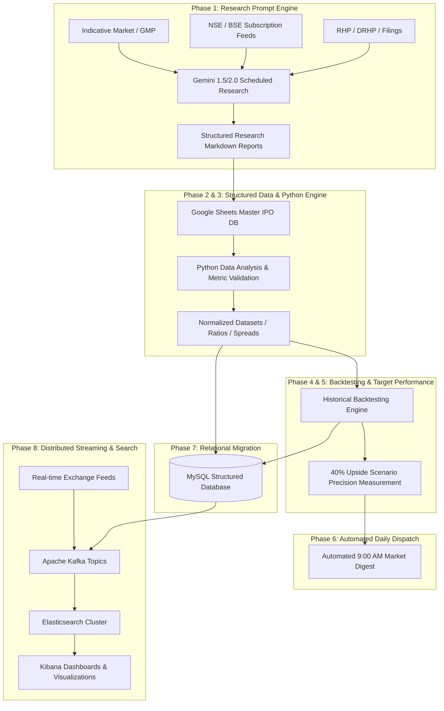

# Platform Architecture & Evolution

This document details the architectural blueprint for the **Indian IPO Research & Data Analysis Platform**. The architecture follows a phased, evolutionary path—starting with rapid, LLM-augmented fundamental research and progressing toward an enterprise-scale distributed streaming and search analytics pipeline.

---

## Phased Architectural Evolution

### Phase 1: Gemini Scheduled IPO Research (Current)
- **Objective:** Deploy standardized prompt templates allowing Gemini to ingest unstructured prospectus text, exchange metrics, and market conditions to produce uniform, high-signal IPO research reports.
- **Components:**
  - **Prompt Registry:** Master prompt with strict analytical guardrails, valuation formulas, and scenario guidelines ([prompts/phase1_ipo_research_prompt.md](file:///c:/Users/omsin/OneDrive/Desktop/IPO-Recomendation-platform/prompts/phase1_ipo_research_prompt.md)).
  - **Output Artifacts:** Markdown-based research reports stored in `reports/` following a standardized 13-section structure.
  - **Validation Principles:** Explicit source tracking, distinction between verified vs. indicative metrics, and prohibition of guaranteed profit claims.

### Phase 2: Google Sheets IPO Database
- **Objective:** Establish a lightweight, accessible, and collaborative tabular datastore for tracked IPOs.
- **Components:**
  - **Sheets Schema:** Columns for Issue Details, Timelines, Financial Statements (3-yr restated), Valuation Ratios, Segmented Subscription multiples (QIB, NII, Retail), and daily GMP updates.
  - **Interface:** Google Sheets API service account integration for programmatic reads and writes.
  - **Data Synchronization:** Manual or scripted ingestion from Phase 1 report outputs into structured tabular rows.

### Phase 3: Python Data Analysis
- **Objective:** Introduce automated computational scripts in Python to validate raw figures and compute comparative financial metrics.
- **Components:**
  - **Core Libraries:** `pandas`, `numpy`, `scipy`.
  - **Analytical Modules:**
    - **Valuation Normalizer:** Computes adjusted P/E, P/B, EV/EBITDA, and calculates discount/premium relative to listed peers.
    - **Demand Momentum Index:** Tracks acceleration of subscription book-building across Day 1, Day 2, and Day 3.
    - **Quality Scorecard:** Rule-based algorithmic scoring based on ROE, ROCE, debt-to-equity, and profit margins.

### Phase 4: Historical Backtesting Engine
- **Objective:** Programmatically evaluate past IPO recommendations against actual market listing outcomes and subsequent 30/90/180-day price trajectories.
- **Components:**
  - **Historical Outcome Scraper:** Extracts listing day open, high, low, close, and listing gain percentage from NSE/BSE archives.
  - **Model Evaluation:** Compares the predicted scenario ranges (Conservative, Base, Optimistic) against empirical listing day performance.
  - **Hypothesis Testing:** Quantifies accuracy, hit-rate, false-positive ratios, and drawdown risks across varying market cycles (bull, bear, consolidation).

### Phase 5: 40% Target Performance Measurement
- **Objective:** Dedicated analytical module to audit and calibrate the criteria triggering the conditional "40%+ Upside Scenario".
- **Components:**
  - **Precision & Recall Tracking:** Evaluates how frequently IPOs marked with a plausible 40%+ scenario actually achieved that threshold on listing.
  - **Key Factor Attribution:** Multi-variate attribution analyzing which variables (e.g., QIB subscription > 50x, anchor book quality, negative debt, high GMP-to-Issue-Price ratio) contributed most reliably to high-alpha outcomes.
  - **Scenario Calibration:** Tightens or loosens triggering thresholds to minimize downside risk for platform consumers.

### Phase 6: Automated 9:00 AM Daily Report
- **Objective:** Provide a consolidated, automated intelligence briefing delivered daily at 9:00 AM IST prior to Indian market opening.
- **Components:**
  - **Scheduler:** Cron-based or task-orchestrated execution trigger.
  - **Synthesis Engine:** Aggregates active IPO statuses (open, closing today, allotment pending, listing today), latest overnight GMP movements, and final day subscription projections.
  - **Distribution Channels:** Automated markdown generation, email dispatch (SMTP), or messaging webhooks.

### Phase 7: MySQL Database Migration
- **Objective:** Transition from spreadsheet-based tracking to an ACID-compliant relational schema to handle complex multi-year IPO data, peer mapping, and longitudinal financials.
- **Components:**
  - **Database Engine:** MySQL 8.0+.
  - **Relational Schema:**
    - `companies`: Primary entity information, CIN, sector, promoter background.
    - `ipo_issues`: Dates, price bands, issue sizes, fresh/OFS breakdown, lot sizes.
    - `financials`: Multi-year restated balance sheets, P&L, cash flows, audit qualifications.
    - `subscriptions`: Time-series subscription bids across investor categories.
    - `gmp_history`: Time-series tracking of indicative grey market rates with timestamps.
    - `outcomes`: Listing price, 52-week highs/lows, benchmark returns.

### Phase 8: Kafka -> Elasticsearch -> Kibana (Real-Time & Distributed Analytics)
- **Objective:** High-throughput event streaming, full-text prospectus indexing, and visual analytics dashboards.
- **Components:**
  - **Apache Kafka:** Event streaming bus ingesting real-time exchange order book feeds, news alerts, and regulatory filings into partitioned topics (`ipo-bids-topic`, `gmp-feed-topic`, `regulatory-filings`).
  - **Elasticsearch:** Distributed search engine providing full-text search across DRHP/RHP filings (e.g., searching litigations, supply dependencies, specific customer concentrations) and storing structured metrics.
  - **Kibana:** Executive dashboards rendering live subscription heatmaps, historical listing gain distributions, peer valuation scatterplots, and real-time alerts.

---

## Architectural Principles & Guardrails

1. **Decoupled Progression:** No phase is dependent on premature infrastructure. Each phase delivers standalone research utility.
2. **Data Lineage & Reproducibility:** Every analytical conclusion must be traceable back to its underlying audited filing, exchange report, or recorded market observation.
3. **Strict Research Boundary:** The architecture strictly excludes automated order routing, broker API execution, or proprietary trading mechanisms.
