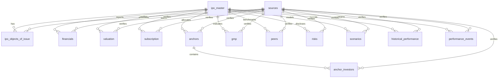

# MySQL Relational Database Schema Design

**Logical Database Name:** `ipo_recommendation`  
**Schema Version:** `1.0`  
**System Role:** Primary System of Record for the Indian IPO Research Platform  
**Downstream Consumers:**  
- Phase 3: Python Data Analysis Engine  
- Phase 4: Historical Backtesting Engine  
- Phase 5: 40% Target Performance Measurement  
- Phase 6: Automated 9:00 AM Daily Briefing  
- Database Implementation Boundary: MySQL is the sole Primary System of Record. Elasticsearch and Kibana are NOT part of this project and will not be implemented.  

> **CRITICAL ARCHITECTURAL DIRECTIVE & SAFETY NOTICE**  
> **DESIGN ONLY — NOT EXECUTED:** This document contains the complete relational architecture, entity-relationship diagrams, and prospective Data Definition Language (DDL) for the platform. No database instances, live tables, indexes, or production records have been created or executed in this step. Elasticsearch and Kibana are NOT part of this project roadmap.

---

## 1. System Role & Database Principles

### 1.1 Shift from Spreadsheets to System of Record
In Phase 2, MySQL replaces spreadsheets as the **authoritative primary system of record**. Google Sheets is strictly an optional future reporting and manual presentation layer that reads from MySQL, preventing split-brain states or untracked manual edits.

### 1.2 Core Architectural Principles
1. **Third Normal Form (3NF) Normalization:** Master IPO parameters are isolated from multi-period financials, daily bidding snapshots, anchor investor rosters, grey market indications, peer metrics, and post-listing performance.
2. **Strict Sourcing & Provenance:** Every financial figure, subscription multiple, and disclosed risk carries a foreign key link to a centralized `sources` registry with exact URLs, dates, and retrieval timestamps.
3. **No Overwriting of Raw Data:** Reported filings numbers are stored as ground truth. Programmatically derived metrics (CAGR, EBITDA margins, implied P/E, 40% target price) are stored in dedicated calculated columns or generated at query time.
4. **Data-Type State Machine & Mixed Provenance Resolution:** Quantitative records maintain clear provenance categorization (`'Reported'`, `'Calculated'`, `'Estimate'`, or `'Not available'`). Because a single financial or operational row contains multiple metrics with potentially differing provenance (e.g., reported revenue alongside calculated margins or missing cash flow metrics), individual metric provenance is resolved via explicit database rules:
   - **Reported:** Ground truth figures extracted verbatim from regulatory filings (DRHP/RHP, exchange circulars). These values are immutable and are never overwritten by calculated numbers.
   - **Calculated:** Values mathematically derived via deterministic formulas (e.g., ratios, percentage growths, multiples, virtual generated columns).
   - **Estimate:** Forward-looking projections or management guidance explicitly tagged as non-audited estimates.
   - **Not available:** Represented natively as standard SQL `NULL` for missing metrics, rather than imputing zeros or synthetic defaults.
   - **Row-Level `data_type` vs Column Granularity:** The row-level `data_type` in tables like `financials` and `valuation` characterizes the primary classification of the underlying financial statement or valuation report from its referenced `source_id`. For columns within that record:
     - An audited filing row (`data_type = 'Reported'`, linked to `sources` with `source_date` and `retrieval_timestamp`) stores reported line items as exact values.
     - Columns containing derived figures within that row (e.g., margins, ratios) represent deterministic calculations derived directly from the reported inputs.
     - Columns for metrics not disclosed in the source filing evaluate to `NULL` (indicating 'Not available') without invalidating the 'Reported' status of the disclosed items.
5. **Elimination of Look-Ahead Bias:** Strict architectural partitioning between **Pre-IPO Research Data** (available prior to trading) and **Post-Listing Performance Data** (recorded after listing day). Historical backtesting models are barred from referencing post-listing records during historical decision-point simulations.
6. **No Subjective Bias or Recommendations:** The schema strictly forbids fields for investment ratings, buy/sell/apply signals, composite ranking scores, or anchor investor "quality" assessments.
7. **Unofficial Nature of GMP:** Grey Market Premium is isolated in a time-series table tagged strictly as `'Unofficial GMP'`, explicitly barred from triggering or validating upside scenarios independently.
8. **Enterprise Streaming & CDC Readiness:** Tables feature monotonically increasing surrogate keys (`BIGINT AUTO_INCREMENT`), business keys (`ipo_id`), row update timestamps (`updated_at`), and soft-delete flags (`is_active`, `deleted_at`) for Debezium CDC ingestion into Apache Kafka.
9. **Current and Historical IPO Support:** The schema provides uniform support for both live/upcoming offerings (e.g., Moneyview Limited) and completed historical issues (e.g., NTPC Green Energy Limited, listed in 2024). NTPC Green Energy is treated strictly as a **historical IPO** within historical backtesting and performance evaluation datasets.

### 1.3 Phase 2 Step 1B Audit Addendum: Authoritative Design Counts & Provenance Governance
During the Phase 2 Step 1B final consistency audit, all metrics, constraints, and relationships were reconciled against the authoritative database design:
1. **Authoritative Design Metric Breakdown:**
   - **Total Tables (14):** 14 fully normalized relational tables (12 Pre-IPO tables and 2 Post-Listing tables).
   - **Total Primary Keys (14):** Exactly 14 primary keys. Each table utilizes a dedicated clustered surrogate key (`id BIGINT UNSIGNED AUTO_INCREMENT PRIMARY KEY`).
   - **Physical Foreign-Key Constraints in DDL (25):** Exactly 25 foreign key constraints are enforced in the SQL DDL:
     - 11 child-to-parent constraints targeting `ipo_master(ipo_id)`.
     - 1 hierarchical child constraint from `anchor_investors(anchor_id)` targeting `anchors(anchor_id)`.
     - 13 provenance lineage constraints targeting `sources(source_id)` from `ipo_master` and 12 child observation tables.
   - **Logical Entity Relationships (24):** Physical foreign key constraints do not equal logical domain relationships. The schema models 24 logical domain relationships:
     - 11 direct entity relationships from `ipo_master` to child entity domains (`ipo_objects_of_issue`, `financials`, `valuation`, `subscription`, `anchors`, `gmp`, `peers`, `risks`, `scenarios`, `historical_performance`, `performance_events`).
     - 1 hierarchical composition relationship between `anchors` and individual `anchor_investors`.
     - 12 provenance verification relationships linking `ipo_master` and observation domains to authoritative `sources`.
   - **Total Index Count (61):** The physical schema contains 61 distinct indexes across three clear architectural categories:
     - **14 Primary-Key Indexes:** Clustered B-tree indexes generated on `id BIGINT UNSIGNED AUTO_INCREMENT` across all 14 tables.
     - **8 Unique Secondary Indexes:** Enforce natural key uniqueness without preventing legitimate multi-period/multi-snapshot observations (`sources.source_id`, `ipo_master.ipo_id`, `ipo_master.isin`, `financials(ipo_id, financial_period)`, `subscription(ipo_id, subscription_date, subscription_day)`, `anchors.anchor_id`, `gmp(ipo_id, gmp_date, gmp_time)`, `scenarios(ipo_id)`).
     - **39 Secondary / Performance Indexes:** Foreign key lookup indexes and composite query-acceleration indexes covering temporal, status, sector, and event query paths.
2. **Delete-Safety Governance:** 100% of the 25 foreign key constraints enforce `ON UPDATE CASCADE ON DELETE RESTRICT`. Cascading deletions (`ON DELETE CASCADE`) are entirely barred, safeguarding historical research archives and backtesting integrity.
3. **Point-in-Time Sourcing Lineage:** Every source-sensitive observation ties to `sources` via `source_id`, carrying `source_name`, `source_url`, `source_type`, `publication_date`, and `retrieval_timestamp`.
4. **Current vs. Historical Classification:** NTPC Green Energy Limited is confirmed and documented as a historical IPO (listed in 2024). Moneyview Limited is documented as a current IPO example based strictly on the audited Phase 1 research report. No live database execution or new research was conducted.

---

## 2. Entity-Relationship Overview



---

## 3. Relational Table Specifications

### Table 1: `sources` (Centralized Provenance Registry)
Stores the authoritative lineage for every data point across the platform.

- **Primary Key:** `id` (BIGINT UNSIGNED AUTO_INCREMENT)
- **Business Key:** `source_id` (VARCHAR(64) UNIQUE)

| Column Name | Data Type | Nullable | Constraints / Enum | Description |
| :--- | :--- | :--- | :--- | :--- |
| `id` | BIGINT UNSIGNED | No | PK, AUTO_INCREMENT | Internal surrogate primary key |
| `source_id` | VARCHAR(64) | No | UNIQUE | Deterministic key (e.g., `SRC-MV-RHP-2026`) |
| `source_name` | VARCHAR(255) | No | | Document or organization name |
| `source_url` | TEXT | Yes | | Full web URL to filing or notice |
| `source_type` | ENUM | No | `'NSE'`, `'BSE'`, `'SEBI'`, `'Official Offer Document'`, `'Company Filing'`, `'Registrar'`, `'Financial Publication'`, `'GMP Source'`, `'Calculated'`, `'Other'` | Provenance authority classification |
| `publication_date` | DATE | Yes | | Date the source was officially published |
| `retrieval_timestamp`| DATETIME | No | | Exact timestamp when data was fetched |
| `page_or_section` | VARCHAR(255) | Yes | | RHP page/table number or exchange circular ID |
| `data_type` | ENUM | No | `'Reported'`, `'Calculated'`, `'Estimate'`, `'Not available'` | Operational data classification |
| `notes` | TEXT | Yes | | Analyst audit commentary |
| `created_at` | TIMESTAMP | No | DEFAULT CURRENT_TIMESTAMP | Row creation time |
| `updated_at` | TIMESTAMP | No | DEFAULT CURRENT_TIMESTAMP ON UPDATE CURRENT_TIMESTAMP | Row update time |

---

### Table 2: `ipo_master` (Primary IPO Entity)
Maintains commercial, regulatory, and capital structure parameters for each public issue.

- **Primary Key:** `id` (BIGINT UNSIGNED AUTO_INCREMENT)
- **Business Key:** `ipo_id` (VARCHAR(64) UNIQUE)

| Column Name | Data Type | Nullable | Constraints / Enum | Description |
| :--- | :--- | :--- | :--- | :--- |
| `id` | BIGINT UNSIGNED | No | PK, AUTO_INCREMENT | Internal surrogate primary key |
| `ipo_id` | VARCHAR(64) | No | UNIQUE | System-wide slug (e.g., `IND-MB-2026-MONEYVIEW`) |
| `company_name` | VARCHAR(255) | No | | Brand / commercial operating name |
| `company_legal_name`| VARCHAR(255) | No | | Legal entity name registered with SEBI/RoC |
| `ticker_symbol` | VARCHAR(32) | Yes | | Proposed NSE/BSE stock ticker |
| `isin` | VARCHAR(12) | Yes | UNIQUE | International Securities Identification Number |
| `segment` | ENUM | No | `'Mainboard'`, `'SME'` | Market segment (Strictly 1:1, no hybrid tags) |
| `sector` | VARCHAR(128) | No | | Macro industry classification |
| `industry` | VARCHAR(128) | No | | Specific sub-industry niche |
| `status` | ENUM | No | `'Upcoming'`, `'Opening Today'`, `'Currently Open'`, `'Closing Today'`, `'Closed'`, `'Listed'`, `'Withdrawn'`, `'Not Available'` | Operational status as of `data_cutoff` |
| `research_date` | DATE | No | | Date of analyst evaluation |
| `research_time` | TIME | No | | Time of analyst evaluation |
| `data_cutoff` | DATETIME | No | | Cutoff timestamp for input reconciliation |
| `open_date` | DATE | No | | Subscription start date |
| `close_date` | DATE | No | | Subscription close date |
| `listing_date` | DATE | Yes | | Actual or tentative listing date |
| `listing_status` | ENUM | No | `'Pre-Listing'`, `'Listed'`, `'Deferred'` | Secondary market state |
| `issue_size` | DECIMAL(14,2)| No | CHECK (`issue_size` > 0) | Total gross offering amount (₹ Cr) |
| `fresh_issue_amount`| DECIMAL(14,2)| No | DEFAULT 0.00 | Capital raised by issuer company (₹ Cr) |
| `ofs_amount` | DECIMAL(14,2)| No | DEFAULT 0.00 | Secondary shares sold by existing holders (₹ Cr) |
| `fresh_issue_percentage`| DECIMAL(5,2)| Yes | | `(fresh_issue_amount / issue_size) * 100` |
| `ofs_percentage` | DECIMAL(5,2)| Yes | | `(ofs_amount / issue_size) * 100` |
| `face_value` | DECIMAL(8,2) | No | | Nominal face value per equity share (₹) |
| `price_band_low` | DECIMAL(10,2)| Yes | | Floor bidding price (₹) |
| `price_band_high`| DECIMAL(10,2)| No | | Cap bidding price (₹) |
| `issue_price` | DECIMAL(10,2)| Yes | | Final discovered/allotted price (₹) |
| `lot_size` | INT UNSIGNED | No | CHECK (`lot_size` > 0) | Equity shares per bidding lot |
| `minimum_investment`| DECIMAL(12,2)| No | | Minimum retail capital (`lot_size * price_band_high`) |
| `employee_reservation`| DECIMAL(12,2)| Yes | | Employee quota allocation (₹ Cr) |
| `shareholder_reservation`| DECIMAL(12,2)| Yes | | Parent shareholder quota allocation (₹ Cr) |
| `other_reservation` | DECIMAL(12,2)| Yes | | Specialized quota allocation (₹ Cr) |
| `source_id` | VARCHAR(64) | Yes | FK $\rightarrow$ `sources(source_id)` | Baseline offer document reference |
| `is_active` | BOOLEAN | No | DEFAULT TRUE | Soft delete status flag |
| `deleted_at` | DATETIME | Yes | | Soft delete timestamp |
| `created_at` | TIMESTAMP | No | DEFAULT CURRENT_TIMESTAMP | Record insertion timestamp |
| `updated_at` | TIMESTAMP | No | DEFAULT CURRENT_TIMESTAMP ON UPDATE CURRENT_TIMESTAMP | Record modification timestamp |

---

### Table 3: `ipo_objects_of_issue` (Fresh Issue Utilization)
Tracks the designated deployment of fresh capital raised by the company.

- **Primary Key:** `id` (BIGINT UNSIGNED AUTO_INCREMENT)
- **Foreign Key:** `ipo_id` $\rightarrow$ `ipo_master(ipo_id)` ON UPDATE CASCADE ON DELETE RESTRICT

| Column Name | Data Type | Nullable | Constraints / Enum | Description |
| :--- | :--- | :--- | :--- | :--- |
| `id` | BIGINT UNSIGNED | No | PK, AUTO_INCREMENT | Internal surrogate primary key |
| `ipo_id` | VARCHAR(64) | No | FK $\rightarrow$ `ipo_master(ipo_id)` | Parent IPO key |
| `purpose_type` | ENUM | No | `'debt_repayment'`, `'capital_expenditure'`, `'working_capital'`, `'acquisitions_or_MA'`, `'general_corporate_purposes'`, `'issue_expenses'`, `'other_use'` | Standardized capital object category |
| `purpose_description`| TEXT | No | | Full description from RHP Section III |
| `amount` | DECIMAL(12,2)| No | | Allocated capital amount (₹ Cr) |
| `percentage_of_fresh_issue`| DECIMAL(5,2)| Yes | | Percentage share of total fresh issue proceeds |
| `disclosure_status` | ENUM | No | `'Disclosed'`, `'Estimated'`, `'Not available'` | Disclosure rigor |
| `source_id` | VARCHAR(64) | Yes | FK $\rightarrow$ `sources(source_id)` | Source filing reference |
| `created_at` | TIMESTAMP | No | DEFAULT CURRENT_TIMESTAMP | Audit creation timestamp |
| `updated_at` | TIMESTAMP | No | DEFAULT CURRENT_TIMESTAMP ON UPDATE CURRENT_TIMESTAMP | Audit update timestamp |

---

### Table 4: `financials` (Multi-Period Restated Statements)
Captures historical financial performance across audited fiscal years and interim stub periods.

- **Primary Key:** `id` (BIGINT UNSIGNED AUTO_INCREMENT)
- **Unique Constraint:** `(ipo_id, financial_period)`
- **Foreign Key:** `ipo_id` $\rightarrow$ `ipo_master(ipo_id)` ON UPDATE CASCADE ON DELETE RESTRICT

| Column Name | Data Type | Nullable | Constraints / Enum | Description |
| :--- | :--- | :--- | :--- | :--- |
| `id` | BIGINT UNSIGNED | No | PK, AUTO_INCREMENT | Internal surrogate primary key |
| `ipo_id` | VARCHAR(64) | No | FK $\rightarrow$ `ipo_master(ipo_id)` | Parent IPO key |
| `financial_period` | VARCHAR(32) | No | (e.g., `'FY2025'`, `'FY2026'`, `'Q1_FY2027'`) | Period label |
| `period_type` | ENUM | No | `'FY'`, `'Q1'`, `'Q2'`, `'Q3'`, `'Q4'`, `'LTM'`, `'Stub Period'`, `'Not available'` | Period category |
| `revenue` | DECIMAL(14,2)| Yes | | Revenue from Operations (₹ Cr) |
| `revenue_growth` | DECIMAL(8,2) | Yes | | Computed YoY revenue expansion (%) |
| `EBITDA` | DECIMAL(14,2)| Yes | | Operating earnings before interest, tax, dep/amort |
| `EBITDA_margin` | DECIMAL(6,2) | Yes | | `(EBITDA / revenue) * 100` (%) |
| `PAT` | DECIMAL(14,2)| Yes | | Restated Profit After Tax (₹ Cr) |
| `PAT_growth` | DECIMAL(8,2) | Yes | | Computed YoY net profit expansion (%) |
| `EPS` | DECIMAL(10,2)| Yes | | Diluted earnings per share (₹) |
| `book_value_per_share`| DECIMAL(10,2)| Yes | | Net Worth per equity share (₹) |
| `ROE` | DECIMAL(6,2) | Yes | | Return on Equity (%) |
| `ROCE` | DECIMAL(6,2) | Yes | | Return on Capital Employed (%) |
| `total_debt` | DECIMAL(14,2)| Yes | | Total short-term and long-term borrowings (₹ Cr) |
| `net_debt` | DECIMAL(14,2)| Yes | | `total_debt - cash_and_equivalents` (₹ Cr) |
| `debt_equity` | DECIMAL(6,2) | Yes | | Total debt divided by Net Worth (x) |
| `operating_cash_flow`| DECIMAL(14,2)| Yes | | Cash Flow from Operating Activities (₹ Cr) |
| `investing_cash_flow`| DECIMAL(14,2)| Yes | | Cash Flow from Investing Activities (₹ Cr) |
| `financing_cash_flow`| DECIMAL(14,2)| Yes | | Cash Flow from Financing Activities (₹ Cr) |
| `free_cash_flow` | DECIMAL(14,2)| Yes | | `operating_cash_flow - capex` (₹ Cr) |
| `data_type` | ENUM | No | `'Reported'`, `'Calculated'`, `'Estimate'`, `'Not available'` | Metric state flag |
| `source_id` | VARCHAR(64) | Yes | FK $\rightarrow$ `sources(source_id)` | Restated audit statement reference |
| `source_date` | DATE | Yes | | Audit signoff or filing date |
| `created_at` | TIMESTAMP | No | DEFAULT CURRENT_TIMESTAMP | Audit creation timestamp |
| `updated_at` | TIMESTAMP | No | DEFAULT CURRENT_TIMESTAMP ON UPDATE CURRENT_TIMESTAMP | Audit update timestamp |

*Mixed Provenance Resolution Note:* The row-level `data_type` denotes the baseline certification of the filing statement (typically `'Reported'` for statutory audit tables from `sources`). Within any single row:
1. Reported line items (`revenue`, `PAT`, `EBITDA`, `total_debt`) contain immutable factual data directly from the audited financial statement.
2. Formulated line items (`revenue_growth`, `PAT_growth`, `EBITDA_margin`, `debt_equity`) represent deterministic derivations computed from reported inputs; they never overwrite reported values.
3. Items not provided or unstated in the statutory filing (`ROE`, `ROCE`, or `free_cash_flow`) evaluate to `NULL` (indicating `'Not available'`) rather than synthetic or imputed numbers.

---

### Table 5: `valuation` (Pre-Listing Valuation Metrics)
Stores valuation multiples evaluated at upper price band or discovery price.

- **Primary Key:** `id` (BIGINT UNSIGNED AUTO_INCREMENT)
- **Foreign Key:** `ipo_id` $\rightarrow$ `ipo_master(ipo_id)` ON UPDATE CASCADE ON DELETE RESTRICT

| Column Name | Data Type | Nullable | Constraints / Enum | Description |
| :--- | :--- | :--- | :--- | :--- |
| `id` | BIGINT UNSIGNED | No | PK, AUTO_INCREMENT | Internal surrogate primary key |
| `ipo_id` | VARCHAR(64) | No | FK $\rightarrow$ `ipo_master(ipo_id)` | Parent IPO key |
| `issue_price` | DECIMAL(10,2)| No | | Pricing base evaluated (₹) |
| `reference_eps` | DECIMAL(10,2)| Yes | | Base diluted EPS used for multiples (₹) |
| `reference_book_value_per_share`| DECIMAL(10,2)| Yes | | Base net asset value per share (₹) |
| `issue_pe` | DECIMAL(8,2) | Yes | | Computed P/E multiple at reference price |
| `issue_pb` | DECIMAL(8,2) | Yes | | Computed P/B multiple at reference price |
| `industry_pe` | DECIMAL(8,2) | Yes | | Benchmark sector P/E multiple |
| `industry_pb` | DECIMAL(8,2) | Yes | | Benchmark sector P/B multiple |
| `peer_average_pe` | DECIMAL(8,2) | Yes | | Median/mean listed peer P/E multiple |
| `peer_average_pb` | DECIMAL(8,2) | Yes | | Median/mean listed peer P/B multiple |
| `valuation_method` | VARCHAR(255) | Yes | | Valuation methodology notes |
| `valuation_source` | VARCHAR(255) | Yes | | RHP Basis for Issue Price citation |
| `valuation_date` | DATE | Yes | | Date valuation was determined |
| `data_type` | ENUM | No | `'Reported'`, `'Calculated'`, `'Estimate'`, `'Not available'` | Metric state flag |
| `source_id` | VARCHAR(64) | Yes | FK $\rightarrow$ `sources(source_id)` | Valuation source citation |
| `created_at` | TIMESTAMP | No | DEFAULT CURRENT_TIMESTAMP | Audit creation timestamp |
| `updated_at` | TIMESTAMP | No | DEFAULT CURRENT_TIMESTAMP ON UPDATE CURRENT_TIMESTAMP | Audit update timestamp |

*Mixed Provenance Resolution Note:* In `valuation`, the record-level `data_type` characterizes the valuation assessment set (e.g. `'Calculated'` for analyst computed multiples, or `'Reported'` when quoting the RHP Basis for Issue Price). Within the record:
1. Inputs (`reference_eps`, `reference_book_value_per_share`, `issue_price`) represent reported figures from offer documents.
2. Implied multiples (`issue_pe`, `issue_pb`) represent exact calculated metrics (`issue_price / reference_eps`).
3. Sector and peer medians (`industry_pe`, `peer_average_pe`) reflect reported benchmarks or consensus estimates from financial data sources.
4. Any non-calculable or undisclosed benchmark evaluates strictly to `NULL` ('Not available').

---

### Table 6: `subscription` (Time-Series Order Book Snapshots)
Supports multiple intra-day and end-of-day bidding logs across investor tiers.

- **Primary Key:** `id` (BIGINT UNSIGNED AUTO_INCREMENT)
- **Unique Constraint:** `(ipo_id, subscription_date, subscription_day)`
- **Foreign Key:** `ipo_id` $\rightarrow$ `ipo_master(ipo_id)` ON UPDATE CASCADE ON DELETE RESTRICT

| Column Name | Data Type | Nullable | Description |
| :--- | :--- | :--- | :--- |
| `id` | BIGINT UNSIGNED | No | Internal surrogate primary key |
| `ipo_id` | VARCHAR(64) | No | Parent IPO key |
| `subscription_date` | DATE | No | Exchange bidding date |
| `subscription_day` | VARCHAR(16) | No | Sequence identifier (`'Day 1'`, `'Day 2'`, `'Day 3'`, `'Final'`) |
| `QIB_shares_offered`| BIGINT UNSIGNED | Yes | Shares reserved for QIB tier (ex-Anchor) |
| `QIB_shares_bid` | BIGINT UNSIGNED | Yes | Total cumulative shares bid by QIBs |
| `QIB_subscription_multiple`| DECIMAL(8,2)| Yes | `QIB_shares_bid / QIB_shares_offered` |
| `NII_total_shares_offered`| BIGINT UNSIGNED | Yes | Total shares reserved for NII / HNI tier |
| `NII_total_shares_bid`| BIGINT UNSIGNED | Yes | Total cumulative shares bid by NIIs |
| `NII_total_subscription_multiple`| DECIMAL(8,2)| Yes | `NII_total_shares_bid / NII_total_shares_offered` |
| `sHNI_shares_offered`| BIGINT UNSIGNED | Yes | Shares reserved for small HNIs (₹2L–₹10L) |
| `sHNI_shares_bid` | BIGINT UNSIGNED | Yes | Total cumulative shares bid by sHNIs |
| `sHNI_subscription_multiple`| DECIMAL(8,2)| Yes | `sHNI_shares_bid / sHNI_shares_offered` |
| `bHNI_shares_offered`| BIGINT UNSIGNED | Yes | Shares reserved for big HNIs (> ₹10L) |
| `bHNI_shares_bid` | BIGINT UNSIGNED | Yes | Total cumulative shares bid by bHNIs |
| `bHNI_subscription_multiple`| DECIMAL(8,2)| Yes | `bHNI_shares_bid / bHNI_shares_offered` |
| `retail_shares_offered`| BIGINT UNSIGNED | Yes | Shares reserved for Retail Individual Investors |
| `retail_shares_bid` | BIGINT UNSIGNED | Yes | Total cumulative shares bid by Retail |
| `retail_subscription_multiple`| DECIMAL(8,2)| Yes | `retail_shares_bid / retail_shares_offered` |
| `employee_subscription`| DECIMAL(8,2)| Yes | Subscription multiple for employee quota |
| `shareholder_subscription`| DECIMAL(8,2)| Yes | Subscription multiple for parent shareholder quota |
| `other_subscription`| DECIMAL(8,2)| Yes | Subscription multiple for specialized quotas |
| `total_subscription`| DECIMAL(8,2)| No | Overall total issue subscription multiple |
| `source_id` | VARCHAR(64) | Yes | FK $\rightarrow$ `sources(source_id)` (Exchange bidding feed) |
| `source_date` | DATE | Yes | Bidding feed circular date |
| `retrieval_timestamp`| DATETIME | No | Real-time fetch timestamp |
| `created_at` | TIMESTAMP | No | Audit creation timestamp |
| `updated_at` | TIMESTAMP | No | Audit update timestamp |

---

### Table 7: `anchors` (Master Anchor Placement Header)
Records the aggregated anchor book metrics.

- **Primary Key:** `id` (BIGINT UNSIGNED AUTO_INCREMENT)
- **Business Key:** `anchor_id` (VARCHAR(64) UNIQUE)
- **Foreign Key:** `ipo_id` $\rightarrow$ `ipo_master(ipo_id)` ON UPDATE CASCADE ON DELETE RESTRICT

| Column Name | Data Type | Nullable | Description |
| :--- | :--- | :--- | :--- |
| `id` | BIGINT UNSIGNED | No | Internal surrogate primary key |
| `anchor_id` | VARCHAR(64) | No | Business key (e.g., `ANC-MV-2026`) |
| `ipo_id` | VARCHAR(64) | No | Parent IPO key |
| `anchor_allocation`| DECIMAL(12,2)| No | Gross capital raised from anchor placement (₹ Cr) |
| `anchor_price` | DECIMAL(10,2)| No | Fixed anchor issue price (₹ per share) |
| `anchor_investor_count`| INT UNSIGNED | No | Total institutional accounts participating |
| `anchor_allocation_percentage`| DECIMAL(5,2)| Yes | Anchor allocation share of total issue size (%) |
| `lock_in_30_day` | DATE | No | Expiry date for first 50% anchor shares (30 days from allotment) |
| `lock_in_90_day` | DATE | No | Expiry date for remaining 50% shares (90 days from allotment) |
| `source_id` | VARCHAR(64) | Yes | FK $\rightarrow$ `sources(source_id)` (BSE/NSE Anchor Notice) |
| `source_date` | DATE | Yes | Anchor release date |
| `created_at` | TIMESTAMP | No | Audit creation timestamp |
| `updated_at` | TIMESTAMP | No | Audit update timestamp |

---

### Table 8: `anchor_investors` (Granular Institutional Roster)
Stores individual institutional allotments under the anchor book.

- **Primary Key:** `id` (BIGINT UNSIGNED AUTO_INCREMENT)
- **Foreign Key:** `anchor_id` $\rightarrow$ `anchors(anchor_id)` ON UPDATE CASCADE ON DELETE RESTRICT

| Column Name | Data Type | Nullable | Constraints / Enum | Description |
| :--- | :--- | :--- | :--- | :--- |
| `id` | BIGINT UNSIGNED | No | PK, AUTO_INCREMENT | Internal surrogate primary key |
| `anchor_id` | VARCHAR(64) | No | FK $\rightarrow$ `anchors(anchor_id)` | Parent anchor header key |
| `investor_name` | VARCHAR(255) | No | | Disclosed institutional entity name |
| `investor_type` | ENUM | No | `'DII'`, `'FPI'`, `'Mutual Fund'`, `'Insurance'`, `'Other'`, `'Not available'` | Institutional classification per filings |
| `allocation_amount`| DECIMAL(12,2)| No | | Gross capital allocated (₹ Cr) |
| `allocation_shares`| BIGINT UNSIGNED | No | | Number of equity shares allotted |
| `allocation_percentage`| DECIMAL(5,2)| Yes | | Percentage share of total anchor book (%) |
| `anchor_price` | DECIMAL(10,2)| No | | Allotment price (₹) |
| `source_id` | VARCHAR(64) | Yes | FK $\rightarrow$ `sources(source_id)` | Specific circular citation |
| `source_date` | DATE | Yes | | Circular release date |
| `created_at` | TIMESTAMP | No | DEFAULT CURRENT_TIMESTAMP | Audit creation timestamp |
| `updated_at` | TIMESTAMP | No | DEFAULT CURRENT_TIMESTAMP ON UPDATE CURRENT_TIMESTAMP | Audit update timestamp |

*Governance Guardrail:* Fields such as `anchor_quality_score`, `anchor_rating`, or `anchor_strength` are strictly excluded.

---

### Table 9: `gmp` (Indicative Grey Market Logs)
Time-series tracking of informal over-the-counter quotes.

- **Primary Key:** `id` (BIGINT UNSIGNED AUTO_INCREMENT)
- **Unique Constraint:** `(ipo_id, gmp_date, gmp_time)`
- **Foreign Key:** `ipo_id` $\rightarrow$ `ipo_master(ipo_id)` ON UPDATE CASCADE ON DELETE RESTRICT

| Column Name | Data Type | Nullable | Constraints / Enum | Description |
| :--- | :--- | :--- | :--- | :--- |
| `id` | BIGINT UNSIGNED | No | PK, AUTO_INCREMENT | Internal surrogate primary key |
| `ipo_id` | VARCHAR(64) | No | FK $\rightarrow$ `ipo_master(ipo_id)` | Parent IPO key |
| `gmp_date` | DATE | No | | Date of OTC quote |
| `gmp_time` | TIME | No | | Time of OTC quote |
| `gmp_value` | DECIMAL(10,2)| No | | Unofficial premium over reference price (₹) |
| `gmp_percentage` | DECIMAL(6,2) | Yes | | `(gmp_value / reference_price) * 100` (%) |
| `reference_price` | DECIMAL(10,2)| No | | Pricing base evaluated (₹) |
| `implied_price` | DECIMAL(10,2)| No | | `reference_price + gmp_value` (₹) |
| `source_id` | VARCHAR(64) | Yes | FK $\rightarrow$ `sources(source_id)` | News / OTC aggregator reference |
| `source_type` | ENUM | No | `'Unofficial GMP'` | Fixed invariant classification |
| `retrieval_timestamp`| DATETIME | No | | Real-time fetch timestamp |
| `created_at` | TIMESTAMP | No | DEFAULT CURRENT_TIMESTAMP | Audit creation timestamp |
| `updated_at` | TIMESTAMP | No | DEFAULT CURRENT_TIMESTAMP ON UPDATE CURRENT_TIMESTAMP | Audit update timestamp |

*Governance Mandate:* The schema explicitly documents that GMP is unofficial, unregulated, fluctuates rapidly, does not guarantee listing price, and cannot independently determine scenario classifications. Prohibited: `gmp_signal`, `gmp_buy_score`, `gmp_confidence`.

---

### Table 10: `peers` (Listed Competitor Benchmarks)
Maintains comparative operating metrics for direct domestic listed competitors.

- **Primary Key:** `id` (BIGINT UNSIGNED AUTO_INCREMENT)
- **Foreign Key:** `ipo_id` $\rightarrow$ `ipo_master(ipo_id)` ON UPDATE CASCADE ON DELETE RESTRICT

| Column Name | Data Type | Nullable | Description |
| :--- | :--- | :--- | :--- |
| `id` | BIGINT UNSIGNED | No | Internal surrogate primary key |
| `ipo_id` | VARCHAR(64) | No | Parent IPO key |
| `peer_company_name`| VARCHAR(255) | No | Statutory name of listed peer |
| `ticker` | VARCHAR(32) | No | NSE/BSE stock ticker |
| `market_cap` | DECIMAL(14,2)| Yes | Listed market capitalization (₹ Cr) |
| `revenue` | DECIMAL(14,2)| Yes | Trailing FY revenue from operations (₹ Cr) |
| `PAT` | DECIMAL(14,2)| Yes | Trailing FY profit after tax (₹ Cr) |
| `EPS` | DECIMAL(10,2)| Yes | Trailing diluted EPS (₹) |
| `PE` | DECIMAL(8,2) | Yes | Trailing P/E multiple |
| `PB` | DECIMAL(8,2) | Yes | Price-to-Book multiple |
| `ROE` | DECIMAL(6,2) | Yes | Return on Equity (%) |
| `ROCE` | DECIMAL(6,2) | Yes | Return on Capital Employed (%) |
| `debt_equity` | DECIMAL(6,2) | Yes | Debt-to-Equity ratio (x) |
| `source_id` | VARCHAR(64) | Yes | FK $\rightarrow$ `sources(source_id)` (Annual report / exchange feed) |
| `source_date` | DATE | Yes | Peer filing reference date |
| `created_at` | TIMESTAMP | No | Audit creation timestamp |
| `updated_at` | TIMESTAMP | No | Audit update timestamp |

---

### Table 11: `risks` (Disclosed Risk Factors)
Stores material risk disclosures extracted from statutory RHP filings.

- **Primary Key:** `id` (BIGINT UNSIGNED AUTO_INCREMENT)
- **Foreign Key:** `ipo_id` $\rightarrow$ `ipo_master(ipo_id)` ON UPDATE CASCADE ON DELETE RESTRICT

| Column Name | Data Type | Nullable | Constraints / Enum | Description |
| :--- | :--- | :--- | :--- | :--- |
| `id` | BIGINT UNSIGNED | No | PK, AUTO_INCREMENT | Internal surrogate primary key |
| `ipo_id` | VARCHAR(64) | No | FK $\rightarrow$ `ipo_master(ipo_id)` | Parent IPO key |
| `risk_type` | ENUM | No | `'business'`, `'financial'`, `'debt'`, `'sector'`, `'regulatory'`, `'valuation'`, `'customer_concentration'`, `'promoter'`, `'execution'`, `'market'`, `'other'` | Standard risk category |
| `risk_description` | TEXT | No | | Verbatim summary from RHP Section II |
| `severity` | ENUM | No | `'High'`, `'Medium'`, `'Low'`, `'Not available'` | Qualitative analyst severity tag |
| `source_id` | VARCHAR(64) | Yes | FK $\rightarrow$ `sources(source_id)` | Prospectus section reference |
| `source_date` | DATE | Yes | | Prospectus publication date |
| `created_at` | TIMESTAMP | No | DEFAULT CURRENT_TIMESTAMP | Audit creation timestamp |
| `updated_at` | TIMESTAMP | No | DEFAULT CURRENT_TIMESTAMP ON UPDATE CURRENT_TIMESTAMP | Audit update timestamp |

*Prohibition:* Severity remains descriptive and must never be converted into an overall algorithmic recommendation score.

---

### Table 12: `scenarios` (40% Upside Scenario Model)
Stores the standardized +40% listing scenario analysis.

- **Primary Key:** `id` (BIGINT UNSIGNED AUTO_INCREMENT)
- **Unique Constraint:** `ipo_id`
- **Foreign Key:** `ipo_id` $\rightarrow$ `ipo_master(ipo_id)` ON UPDATE CASCADE ON DELETE RESTRICT

| Column Name | Data Type | Nullable | Constraints / Enum | Description |
| :--- | :--- | :--- | :--- | :--- |
| `id` | BIGINT UNSIGNED | No | PK, AUTO_INCREMENT | Internal surrogate primary key |
| `ipo_id` | VARCHAR(64) | No | UNIQUE, FK $\rightarrow$ `ipo_master(ipo_id)` | Parent IPO key |
| `reference_price` | DECIMAL(10,2)| No | | Pricing base evaluated (₹) |
| `target_price` | DECIMAL(10,2)| No | | `reference_price * 1.40` (₹) |
| `required_price_movement`| DECIMAL(5,2)| No | DEFAULT 40.00 | Fixed move required (+40.00%) |
| `target_pe` | DECIMAL(8,2) | Yes | | `target_price / reference_eps` |
| `target_pb` | DECIMAL(8,2) | Yes | | `target_price / reference_book_value` |
| `supporting_factors`| JSON | Yes | | Array of empirical supporting observations |
| `contradictory_factors`| JSON | Yes | | Array of empirical contradictory observations |
| `scenario_status` | ENUM | No | `'Supported'`, `'Not supported'`, `'Insufficient evidence'` | Final analytical status |
| `scenario_methodology`| TEXT | No | | Standard disclaimer text |
| `scenario_data_timestamp`| DATETIME | No | | Timestamp when scenario was evaluated |
| `source_id` | VARCHAR(64) | Yes | FK $\rightarrow$ `sources(source_id)` | Research report citation |
| `created_at` | TIMESTAMP | No | DEFAULT CURRENT_TIMESTAMP | Audit creation timestamp |
| `updated_at` | TIMESTAMP | No | DEFAULT CURRENT_TIMESTAMP ON UPDATE CURRENT_TIMESTAMP | Audit update timestamp |

*Prohibited Columns:* `probability_of_40_percent`, `expected_return`, `guaranteed_return`, `buy_signal`, `sell_signal`, `recommendation` are strictly barred.

---

### Table 13: `historical_performance` (Post-Listing Aggregates)
Maintains post-listing performance aggregates.

- **Primary Key:** `id` (BIGINT UNSIGNED AUTO_INCREMENT)
- **Foreign Key:** `ipo_id` $\rightarrow$ `ipo_master(ipo_id)` ON UPDATE CASCADE ON DELETE RESTRICT

| Column Name | Data Type | Nullable | Description |
| :--- | :--- | :--- | :--- |
| `id` | BIGINT UNSIGNED | No | Internal surrogate primary key |
| `ipo_id` | VARCHAR(64) | No | Parent IPO key |
| `ipo_year` | SMALLINT UNSIGNED| No | Calendar year of listing |
| `listing_price` | DECIMAL(10,2)| No | Official opening trade price on Day 1 (₹) |
| `listing_day_close` | DECIMAL(10,2)| No | Official closing trade price on Day 1 (₹) |
| `listing_day_high` | DECIMAL(10,2)| Yes | Intraday peak on listing day (₹) |
| `listing_day_low` | DECIMAL(10,2)| Yes | Intraday low on listing day (₹) |
| `listing_day_return` | DECIMAL(8,2) | No | `((listing_day_close - issue_price) / issue_price) * 100` (%) |
| `post_listing_7d_return` | DECIMAL(8,2) | Yes | Percentage return after 7 calendar days (%) |
| `post_listing_30d_return` | DECIMAL(8,2) | Yes | Percentage return after 30 calendar days (%) |
| `post_listing_90d_return` | DECIMAL(8,2) | Yes | Percentage return after 90 calendar days (%) |
| `post_listing_180d_return`| DECIMAL(8,2) | Yes | Percentage return after 180 calendar days (%) |
| `post_listing_1y_return` | DECIMAL(8,2) | Yes | Percentage return after 365 calendar days (%) |
| `max_upside_from_issue_price`| DECIMAL(8,2)| Yes | Peak historical percentage return vs issue price (%) |
| `max_drawdown_from_issue_price`| DECIMAL(8,2)| Yes | Lowest historical percentage return vs issue price (%) |
| `source_id` | VARCHAR(64) | Yes | FK $\rightarrow$ `sources(source_id)` (NSE/BSE Bhavcopy Feed) |
| `created_at` | TIMESTAMP | No | Audit creation timestamp |
| `updated_at` | TIMESTAMP | No | Audit update timestamp |

---

### Table 14: `performance_events` (Longitudinal Event Stream)
Stores daily and milestone price observations for backtesting verification.

- **Primary Key:** `id` (BIGINT UNSIGNED AUTO_INCREMENT)
- **Foreign Key:** `ipo_id` $\rightarrow$ `ipo_master(ipo_id)` ON UPDATE CASCADE ON DELETE RESTRICT

| Column Name | Data Type | Nullable | Constraints / Enum | Description |
| :--- | :--- | :--- | :--- | :--- |
| `id` | BIGINT UNSIGNED | No | PK, AUTO_INCREMENT | Internal surrogate primary key |
| `ipo_id` | VARCHAR(64) | No | FK $\rightarrow$ `ipo_master(ipo_id)` | Parent IPO key |
| `event_date` | DATE | No | | Date of price observation |
| `event_type` | ENUM | No | `'Listing'`, `'Day 1'`, `'Day 7'`, `'Day 30'`, `'Day 90'`, `'Day 180'`, `'1 Year'`, `'Target Reached'`, `'Drawdown'`, `'Other'` | Milestone trigger category |
| `reference_price` | DECIMAL(10,2)| No | | Original benchmark issue price (₹) |
| `market_price` | DECIMAL(10,2)| No | | Closing trade price on `event_date` (₹) |
| `return_percentage` | DECIMAL(8,2) | No | | `((market_price - ref_price) / ref_price) * 100` (%) |
| `days_from_listing` | INT UNSIGNED | No | | Trading/calendar days elapsed since listing |
| `reached_40_percent_target`| BOOLEAN | No | | True if `market_price >= reference_price * 1.40` |
| `source_id` | VARCHAR(64) | Yes | FK $\rightarrow$ `sources(source_id)` | Exchange bhavcopy citation |
| `created_at` | TIMESTAMP | No | DEFAULT CURRENT_TIMESTAMP | Audit creation timestamp |
| `updated_at` | TIMESTAMP | No | DEFAULT CURRENT_TIMESTAMP ON UPDATE CURRENT_TIMESTAMP | Audit update timestamp |

---

## 4. Pre-IPO vs. Post-Listing Separation (Eliminating Look-Ahead Bias)

To ensure scientific validity in Phase 4 backtesting, the schema enforces a strict temporal partition:

```
┌─────────────────────────────────────────────────────────────┐
│                 PRE-IPO INFORMATION BOUNDARY                │
│             (Frozen Prior to Exchange Listing)              │
│                                                             │
│   • ipo_master (price bands, dates, share structures)       │
│   • ipo_objects_of_issue (fresh issue utilization)          │
│   • financials (3-year restated historical balance sheets)   │
│   • valuation (pre-listing issue P/E and P/B multiples)     │
│   • subscription (QIB, sHNI, bHNI, retail final books)       │
│   • anchors & anchor_investors (pre-issue allocations)      │
│   • gmp (unofficial secondary market sentiment logs)        │
│   • peers & risks (disclosed competitive & operational risk)│
│   • scenarios (pre-listing +40% evaluation & target prices) │
│   • sources (pre-listing filing references)                 │
└──────────────────────────────┬──────────────────────────────┘
                               │
               [EXCHANGE LISTING DAY TIMELINE]
                               │
                               ▼
┌─────────────────────────────────────────────────────────────┐
│                POST-LISTING PERFORMANCE STREAM              │
│            (Recorded After Trading Commences)               │
│                                                             │
│   • historical_performance (listing close, 7d/30d/90d returns│
│   • performance_events (longitudinal daily price events)    │
│   • Days elapsed to reach +40% target                       │
│   • Maximum upside and maximum drawdown observed            │
└─────────────────────────────────────────────────────────────┘
```

*Backtesting Governance Rule:* Historical backtesting in Phase 4 may strictly and exclusively use information that would have been available at the historical decision cutoff (`created_at <= open_date` or `created_at <= close_date`). Post-listing performance data (`historical_performance`, `performance_events`) is temporally partitioned and strictly segregated from pre-listing evaluation inputs, preventing look-ahead bias from contaminating historical research models.

---

## 5. Primary Key, Foreign Key & Index Architecture

### 5.1 Primary Key Strategy
- **Surrogate Primary Key (`id` BIGINT UNSIGNED AUTO_INCREMENT):** Used across all tables as the clustered index key in InnoDB, guaranteeing sequential write performance, optimal page fill factors, and minimal leaf-node fragmentation.
- **Natural / Business Key (`ipo_id` VARCHAR(64) UNIQUE):** Immutable, human-readable slug (e.g., `IND-MB-2026-MONEYVIEW`) used as the foreign key target across child tables. This decouples database row IDs from downstream Kafka message keys and Elasticsearch document IDs.

### 5.2 Referential Integrity Rules
- **100% Delete-Safe Architecture:** All 25 foreign key constraints across the schema strictly enforce `ON UPDATE CASCADE ON DELETE RESTRICT`. Cascading deletes (`ON DELETE CASCADE`) are completely barred from the platform, guaranteeing that no historical IPO master record, audited financial statement, subscription observation, anchor placement, GMP log, risk factor, scenario calculation, or backtesting price event can ever be deleted through an accidental parent removal.
- **Anchor Investor Child Table:** Updated from `CASCADE` to `ON DELETE RESTRICT` on `anchor_investors.anchor_id` $\rightarrow$ `anchors.anchor_id` during the Phase 2 Step 1A audit to ensure anchor rosters cannot be deleted by attempting to remove an anchor header.

### 5.3 Index Design & Categorization (61 Total Indexes)
The schema implements a total of **61 distinct indexes** structured across three clear functional categories:

1. **Primary-Key Clustered Indexes (14 Indexes):**
   - Automatically generated on `id BIGINT UNSIGNED AUTO_INCREMENT PRIMARY KEY` across each of the 14 tables, ensuring physical ordering, absence of fragmentation, and $O(\log N)$ point lookups.
2. **Unique Secondary Indexes (8 Indexes):**
   - Enforce business uniqueness without constraining historical observations:
     - `sources.source_id`
     - `ipo_master.ipo_id`
     - `ipo_master.isin` (nullable unique)
     - `financials(ipo_id, financial_period)`
     - `subscription(ipo_id, subscription_date, subscription_day)`
     - `anchors.anchor_id`
     - `gmp(ipo_id, gmp_date, gmp_time)`
     - `scenarios(ipo_id)`
3. **Secondary / Performance Indexes (39 Indexes):**
   - 25 foreign key lookup indexes covering `ipo_id`, `anchor_id`, and `source_id` references to eliminate table scans on joins.
   - 14 composite query-acceleration indexes supporting high-throughput query patterns:
     - `idx_ipo_status_dates` ON `ipo_master(status, open_date, close_date)` (optimizes morning digest queries filtering for currently open or closing issues)
     - `idx_ipo_segment_sector` ON `ipo_master(segment, sector)` (speeds up peer and sector cohort aggregations)
     - `idx_ipo_listing_date` ON `ipo_master(listing_date)` (accelerates listing date discovery)
     - `idx_obj_ipo_purpose` ON `ipo_objects_of_issue(ipo_id, purpose_type)` (speeds up capital expenditure breakdown queries)
     - `idx_fin_period_type` ON `financials(ipo_id, period_type, financial_period)` (accelerates multi-year longitudinal time-series queries)
     - `idx_sub_lookup` ON `subscription(ipo_id, subscription_date)` (optimizes velocity tracking across bidding dates)
     - `idx_source_type_date` ON `sources(source_type, publication_date)` (filters filings by authority and date)
     - `idx_anc_inv_name` ON `anchor_investors(investor_name)` (speeds institutional participant searches)
     - `idx_anc_inv_type` ON `anchor_investors(investor_type)` (accelerates DII vs FPI distribution analysis)
     - `idx_peer_lookup` ON `peers(ipo_id, ticker)` (optimizes listed competitor benchmarking)
     - `idx_risk_lookup` ON `risks(ipo_id, risk_type)` (filters risk disclosures by category)
     - `idx_scen_status` ON `scenarios(ipo_id, scenario_status)` (speeds up +40% scenario status evaluations)
     - `idx_hist_year_return` ON `historical_performance(ipo_year, listing_day_return)` (aggregates annual listing day performance cohorts)
     - `idx_pevent_lookup` ON `performance_events(ipo_id, event_type, days_from_listing)` (enables fast backtesting hit-rate calculations)

---

## 6. Mathematical Formulas & Calculation Governance

The schema distinguishes raw source metrics from calculated outputs:

$$\text{Revenue Growth (\%)} = \left(\frac{\text{revenue}_{\text{current}} - \text{revenue}_{\text{previous}}}{\text{revenue}_{\text{previous}}}\right) \times 100$$

$$\text{PAT Growth (\%)} = \left(\frac{\text{PAT}_{\text{current}} - \text{PAT}_{\text{previous}}}{\text{PAT}_{\text{previous}}}\right) \times 100$$

$$\text{Price-to-Earnings (P/E)} = \frac{\text{issue\_price}}{\text{reference\_eps}}$$

$$\text{Price-to-Book (P/B)} = \frac{\text{issue\_price}}{\text{reference\_book\_value\_per\_share}}$$

$$\text{40\% Target Price (₹)} = \text{reference\_price} \times 1.40$$

$$\text{Required Price Movement (\%)} = \left(\frac{\text{target\_price} - \text{reference\_price}}{\text{reference\_price}}\right) \times 100 = 40.00\%$$

$$\text{Target Implied P/E} = \frac{\text{target\_price}}{\text{reference\_eps}}$$

*Calculation Rule:* When underlying input values (`reference_eps`, `revenue_previous`) are missing or null, the calculated metric must evaluate to `NULL` (`"Not available"`). Never impute zero or approximate figures.

---

## 7. Architecture Boundary & Primary System of Record

> **IMPORTANT ARCHITECTURAL DIRECTIVE:**  
> **Elasticsearch and Kibana are NOT part of this project.** MySQL is the sole authoritative Primary System of Record. Any prior references to an Elasticsearch/Kibana sink represent optional historical reference material and must NOT be implemented or added to the project roadmap. The platform will operate strictly phase-by-phase without Elasticsearch or Kibana.

- **MySQL is the Primary System of Record:** All analytical, research, and backtesting queries in Phases 3, 4, 5, and 6 execute directly against MySQL.
- **No Spring Boot Consumer:** No Spring Boot application or consumer is introduced into any data pipeline.
- **No Elasticsearch or Kibana Implementation:** Search, aggregation, and reporting remain strictly within the approved Phase 2–6 Python, MySQL, and automated reporting boundaries.

---

## 8. Prospective SQL DDL (DESIGN ONLY — NOT EXECUTED)

The following DDL specifies the eventual physical database implementation:

```sql
-- =============================================================================
-- DATABASE DDL: ipo_recommendation
-- STATUS: DESIGN ONLY — NOT EXECUTED
-- COMPLIANCE: MySQL 8.0+ / InnoDB / utf8mb4
-- =============================================================================

-- CREATE DATABASE IF NOT EXISTS ipo_recommendation
--   CHARACTER SET utf8mb4
--   COLLATE utf8mb4_unicode_ci;

-- USE ipo_recommendation;

-- 1. Centralized Provenance Sources Registry
CREATE TABLE IF NOT EXISTS sources (
    id BIGINT UNSIGNED AUTO_INCREMENT PRIMARY KEY,
    source_id VARCHAR(64) NOT NULL UNIQUE,
    source_name VARCHAR(255) NOT NULL,
    source_url TEXT NULL,
    source_type ENUM(
        'NSE', 'BSE', 'SEBI', 'Official Offer Document', 'Company Filing',
        'Registrar', 'Financial Publication', 'GMP Source', 'Calculated', 'Other'
    ) NOT NULL,
    publication_date DATE NULL,
    retrieval_timestamp DATETIME NOT NULL,
    page_or_section VARCHAR(255) NULL,
    data_type ENUM('Reported', 'Calculated', 'Estimate', 'Not available') NOT NULL DEFAULT 'Reported',
    notes TEXT NULL,
    created_at TIMESTAMP NOT NULL DEFAULT CURRENT_TIMESTAMP,
    updated_at TIMESTAMP NOT NULL DEFAULT CURRENT_TIMESTAMP ON UPDATE CURRENT_TIMESTAMP,
    INDEX idx_source_type_date (source_type, publication_date)
) ENGINE=InnoDB DEFAULT CHARSET=utf8mb4 COLLATE=utf8mb4_unicode_ci;

-- 2. Master IPO Entity
CREATE TABLE IF NOT EXISTS ipo_master (
    id BIGINT UNSIGNED AUTO_INCREMENT PRIMARY KEY,
    ipo_id VARCHAR(64) NOT NULL UNIQUE,
    company_name VARCHAR(255) NOT NULL,
    company_legal_name VARCHAR(255) NOT NULL,
    ticker_symbol VARCHAR(32) NULL,
    isin VARCHAR(12) NULL UNIQUE,
    segment ENUM('Mainboard', 'SME') NOT NULL,
    sector VARCHAR(128) NOT NULL,
    industry VARCHAR(128) NOT NULL,
    status ENUM(
        'Upcoming', 'Opening Today', 'Currently Open', 'Closing Today',
        'Closed', 'Listed', 'Withdrawn', 'Not Available'
    ) NOT NULL,
    research_date DATE NOT NULL,
    research_time TIME NOT NULL,
    data_cutoff DATETIME NOT NULL,
    open_date DATE NOT NULL,
    close_date DATE NOT NULL,
    listing_date DATE NULL,
    listing_status ENUM('Pre-Listing', 'Listed', 'Deferred') NOT NULL DEFAULT 'Pre-Listing',
    issue_size DECIMAL(14,2) NOT NULL,
    fresh_issue_amount DECIMAL(14,2) NOT NULL DEFAULT 0.00,
    ofs_amount DECIMAL(14,2) NOT NULL DEFAULT 0.00,
    fresh_issue_percentage DECIMAL(5,2) NULL,
    ofs_percentage DECIMAL(5,2) NULL,
    face_value DECIMAL(8,2) NOT NULL,
    price_band_low DECIMAL(10,2) NULL,
    price_band_high DECIMAL(10,2) NOT NULL,
    issue_price DECIMAL(10,2) NULL,
    lot_size INT UNSIGNED NOT NULL,
    minimum_investment DECIMAL(12,2) NOT NULL,
    employee_reservation DECIMAL(12,2) NULL,
    shareholder_reservation DECIMAL(12,2) NULL,
    other_reservation DECIMAL(12,2) NULL,
    source_id VARCHAR(64) NULL,
    is_active BOOLEAN NOT NULL DEFAULT TRUE,
    deleted_at DATETIME NULL,
    created_at TIMESTAMP NOT NULL DEFAULT CURRENT_TIMESTAMP,
    updated_at TIMESTAMP NOT NULL DEFAULT CURRENT_TIMESTAMP ON UPDATE CURRENT_TIMESTAMP,
    CONSTRAINT fk_ipo_master_source FOREIGN KEY (source_id) REFERENCES sources(source_id) ON UPDATE CASCADE ON DELETE RESTRICT,
    INDEX idx_ipo_status_dates (status, open_date, close_date),
    INDEX idx_ipo_segment_sector (segment, sector),
    INDEX idx_ipo_listing_date (listing_date)
) ENGINE=InnoDB DEFAULT CHARSET=utf8mb4 COLLATE=utf8mb4_unicode_ci;

-- 3. Objects of the Issue (Fresh Issue Proceeds Utilization)
CREATE TABLE IF NOT EXISTS ipo_objects_of_issue (
    id BIGINT UNSIGNED AUTO_INCREMENT PRIMARY KEY,
    ipo_id VARCHAR(64) NOT NULL,
    purpose_type ENUM(
        'debt_repayment', 'capital_expenditure', 'working_capital',
        'acquisitions_or_MA', 'general_corporate_purposes', 'issue_expenses', 'other_use'
    ) NOT NULL,
    purpose_description TEXT NOT NULL,
    amount DECIMAL(12,2) NOT NULL,
    percentage_of_fresh_issue DECIMAL(5,2) NULL,
    disclosure_status ENUM('Disclosed', 'Estimated', 'Not available') NOT NULL DEFAULT 'Disclosed',
    source_id VARCHAR(64) NULL,
    created_at TIMESTAMP NOT NULL DEFAULT CURRENT_TIMESTAMP,
    updated_at TIMESTAMP NOT NULL DEFAULT CURRENT_TIMESTAMP ON UPDATE CURRENT_TIMESTAMP,
    CONSTRAINT fk_obj_ipo FOREIGN KEY (ipo_id) REFERENCES ipo_master(ipo_id) ON UPDATE CASCADE ON DELETE RESTRICT,
    CONSTRAINT fk_obj_source FOREIGN KEY (source_id) REFERENCES sources(source_id) ON UPDATE CASCADE ON DELETE RESTRICT,
    INDEX idx_obj_ipo_purpose (ipo_id, purpose_type)
) ENGINE=InnoDB DEFAULT CHARSET=utf8mb4 COLLATE=utf8mb4_unicode_ci;

-- 4. Financial Statements (Multi-Period Restated Statements)
CREATE TABLE IF NOT EXISTS financials (
    id BIGINT UNSIGNED AUTO_INCREMENT PRIMARY KEY,
    ipo_id VARCHAR(64) NOT NULL,
    financial_period VARCHAR(32) NOT NULL,
    period_type ENUM('FY', 'Q1', 'Q2', 'Q3', 'Q4', 'LTM', 'Stub Period', 'Not available') NOT NULL,
    revenue DECIMAL(14,2) NULL,
    revenue_growth DECIMAL(8,2) NULL,
    EBITDA DECIMAL(14,2) NULL,
    EBITDA_margin DECIMAL(6,2) NULL,
    PAT DECIMAL(14,2) NULL,
    PAT_growth DECIMAL(8,2) NULL,
    EPS DECIMAL(10,2) NULL,
    book_value_per_share DECIMAL(10,2) NULL,
    ROE DECIMAL(6,2) NULL,
    ROCE DECIMAL(6,2) NULL,
    total_debt DECIMAL(14,2) NULL,
    net_debt DECIMAL(14,2) NULL,
    debt_equity DECIMAL(6,2) NULL,
    operating_cash_flow DECIMAL(14,2) NULL,
    investing_cash_flow DECIMAL(14,2) NULL,
    financing_cash_flow DECIMAL(14,2) NULL,
    free_cash_flow DECIMAL(14,2) NULL,
    data_type ENUM('Reported', 'Calculated', 'Estimate', 'Not available') NOT NULL DEFAULT 'Reported',
    source_id VARCHAR(64) NULL,
    source_date DATE NULL,
    created_at TIMESTAMP NOT NULL DEFAULT CURRENT_TIMESTAMP,
    updated_at TIMESTAMP NOT NULL DEFAULT CURRENT_TIMESTAMP ON UPDATE CURRENT_TIMESTAMP,
    UNIQUE KEY uq_fin_ipo_period (ipo_id, financial_period),
    CONSTRAINT fk_fin_ipo FOREIGN KEY (ipo_id) REFERENCES ipo_master(ipo_id) ON UPDATE CASCADE ON DELETE RESTRICT,
    CONSTRAINT fk_fin_source FOREIGN KEY (source_id) REFERENCES sources(source_id) ON UPDATE CASCADE ON DELETE RESTRICT,
    INDEX idx_fin_period_type (ipo_id, period_type, financial_period)
) ENGINE=InnoDB DEFAULT CHARSET=utf8mb4 COLLATE=utf8mb4_unicode_ci;

-- 5. Valuation Benchmarks
CREATE TABLE IF NOT EXISTS valuation (
    id BIGINT UNSIGNED AUTO_INCREMENT PRIMARY KEY,
    ipo_id VARCHAR(64) NOT NULL,
    issue_price DECIMAL(10,2) NOT NULL,
    reference_eps DECIMAL(10,2) NULL,
    reference_book_value_per_share DECIMAL(10,2) NULL,
    issue_pe DECIMAL(8,2) NULL,
    issue_pb DECIMAL(8,2) NULL,
    industry_pe DECIMAL(8,2) NULL,
    industry_pb DECIMAL(8,2) NULL,
    peer_average_pe DECIMAL(8,2) NULL,
    peer_average_pb DECIMAL(8,2) NULL,
    valuation_method VARCHAR(255) NULL,
    valuation_source VARCHAR(255) NULL,
    valuation_date DATE NULL,
    data_type ENUM('Reported', 'Calculated', 'Estimate', 'Not available') NOT NULL DEFAULT 'Calculated',
    source_id VARCHAR(64) NULL,
    created_at TIMESTAMP NOT NULL DEFAULT CURRENT_TIMESTAMP,
    updated_at TIMESTAMP NOT NULL DEFAULT CURRENT_TIMESTAMP ON UPDATE CURRENT_TIMESTAMP,
    CONSTRAINT fk_val_ipo FOREIGN KEY (ipo_id) REFERENCES ipo_master(ipo_id) ON UPDATE CASCADE ON DELETE RESTRICT,
    CONSTRAINT fk_val_source FOREIGN KEY (source_id) REFERENCES sources(source_id) ON UPDATE CASCADE ON DELETE RESTRICT,
    INDEX idx_val_ipo (ipo_id)
) ENGINE=InnoDB DEFAULT CHARSET=utf8mb4 COLLATE=utf8mb4_unicode_ci;

-- 6. Subscription Order Book Snapshots
CREATE TABLE IF NOT EXISTS subscription (
    id BIGINT UNSIGNED AUTO_INCREMENT PRIMARY KEY,
    ipo_id VARCHAR(64) NOT NULL,
    subscription_date DATE NOT NULL,
    subscription_day VARCHAR(16) NOT NULL,
    QIB_shares_offered BIGINT UNSIGNED NULL,
    QIB_shares_bid BIGINT UNSIGNED NULL,
    QIB_subscription_multiple DECIMAL(8,2) NULL,
    NII_total_shares_offered BIGINT UNSIGNED NULL,
    NII_total_shares_bid BIGINT UNSIGNED NULL,
    NII_total_subscription_multiple DECIMAL(8,2) NULL,
    sHNI_shares_offered BIGINT UNSIGNED NULL,
    sHNI_shares_bid BIGINT UNSIGNED NULL,
    sHNI_subscription_multiple DECIMAL(8,2) NULL,
    bHNI_shares_offered BIGINT UNSIGNED NULL,
    bHNI_shares_bid BIGINT UNSIGNED NULL,
    bHNI_subscription_multiple DECIMAL(8,2) NULL,
    retail_shares_offered BIGINT UNSIGNED NULL,
    retail_shares_bid BIGINT UNSIGNED NULL,
    retail_subscription_multiple DECIMAL(8,2) NULL,
    employee_subscription DECIMAL(8,2) NULL,
    shareholder_subscription DECIMAL(8,2) NULL,
    other_subscription DECIMAL(8,2) NULL,
    total_subscription DECIMAL(8,2) NOT NULL,
    source_id VARCHAR(64) NULL,
    source_date DATE NULL,
    retrieval_timestamp DATETIME NOT NULL,
    created_at TIMESTAMP NOT NULL DEFAULT CURRENT_TIMESTAMP,
    updated_at TIMESTAMP NOT NULL DEFAULT CURRENT_TIMESTAMP ON UPDATE CURRENT_TIMESTAMP,
    UNIQUE KEY uq_sub_ipo_date_day (ipo_id, subscription_date, subscription_day),
    CONSTRAINT fk_sub_ipo FOREIGN KEY (ipo_id) REFERENCES ipo_master(ipo_id) ON UPDATE CASCADE ON DELETE RESTRICT,
    CONSTRAINT fk_sub_source FOREIGN KEY (source_id) REFERENCES sources(source_id) ON UPDATE CASCADE ON DELETE RESTRICT,
    INDEX idx_sub_lookup (ipo_id, subscription_date)
) ENGINE=InnoDB DEFAULT CHARSET=utf8mb4 COLLATE=utf8mb4_unicode_ci;

-- 7. Anchor Book Header
CREATE TABLE IF NOT EXISTS anchors (
    id BIGINT UNSIGNED AUTO_INCREMENT PRIMARY KEY,
    anchor_id VARCHAR(64) NOT NULL UNIQUE,
    ipo_id VARCHAR(64) NOT NULL,
    anchor_allocation DECIMAL(12,2) NOT NULL,
    anchor_price DECIMAL(10,2) NOT NULL,
    anchor_investor_count INT UNSIGNED NOT NULL,
    anchor_allocation_percentage DECIMAL(5,2) NULL,
    lock_in_30_day DATE NOT NULL,
    lock_in_90_day DATE NOT NULL,
    source_id VARCHAR(64) NULL,
    source_date DATE NULL,
    created_at TIMESTAMP NOT NULL DEFAULT CURRENT_TIMESTAMP,
    updated_at TIMESTAMP NOT NULL DEFAULT CURRENT_TIMESTAMP ON UPDATE CURRENT_TIMESTAMP,
    CONSTRAINT fk_anc_ipo FOREIGN KEY (ipo_id) REFERENCES ipo_master(ipo_id) ON UPDATE CASCADE ON DELETE RESTRICT,
    CONSTRAINT fk_anc_source FOREIGN KEY (source_id) REFERENCES sources(source_id) ON UPDATE CASCADE ON DELETE RESTRICT,
    INDEX idx_anc_ipo (ipo_id)
) ENGINE=InnoDB DEFAULT CHARSET=utf8mb4 COLLATE=utf8mb4_unicode_ci;

-- 8. Anchor Investors Detailed Roster
CREATE TABLE IF NOT EXISTS anchor_investors (
    id BIGINT UNSIGNED AUTO_INCREMENT PRIMARY KEY,
    anchor_id VARCHAR(64) NOT NULL,
    investor_name VARCHAR(255) NOT NULL,
    investor_type ENUM('DII', 'FPI', 'Mutual Fund', 'Insurance', 'Other', 'Not available') NOT NULL DEFAULT 'Other',
    allocation_amount DECIMAL(12,2) NOT NULL,
    allocation_shares BIGINT UNSIGNED NOT NULL,
    allocation_percentage DECIMAL(5,2) NULL,
    anchor_price DECIMAL(10,2) NOT NULL,
    source_id VARCHAR(64) NULL,
    source_date DATE NULL,
    created_at TIMESTAMP NOT NULL DEFAULT CURRENT_TIMESTAMP,
    updated_at TIMESTAMP NOT NULL DEFAULT CURRENT_TIMESTAMP ON UPDATE CURRENT_TIMESTAMP,
    CONSTRAINT fk_anc_inv_header FOREIGN KEY (anchor_id) REFERENCES anchors(anchor_id) ON UPDATE CASCADE ON DELETE RESTRICT,
    CONSTRAINT fk_anc_inv_source FOREIGN KEY (source_id) REFERENCES sources(source_id) ON UPDATE CASCADE ON DELETE RESTRICT,
    INDEX idx_anc_inv_name (investor_name),
    INDEX idx_anc_inv_type (investor_type)
) ENGINE=InnoDB DEFAULT CHARSET=utf8mb4 COLLATE=utf8mb4_unicode_ci;

-- 9. Indicative Grey Market Premium (GMP) Logs
CREATE TABLE IF NOT EXISTS gmp (
    id BIGINT UNSIGNED AUTO_INCREMENT PRIMARY KEY,
    ipo_id VARCHAR(64) NOT NULL,
    gmp_date DATE NOT NULL,
    gmp_time TIME NOT NULL,
    gmp_value DECIMAL(10,2) NOT NULL,
    gmp_percentage DECIMAL(6,2) NULL,
    reference_price DECIMAL(10,2) NOT NULL,
    implied_price DECIMAL(10,2) NOT NULL,
    source_id VARCHAR(64) NULL,
    source_type ENUM('Unofficial GMP') NOT NULL DEFAULT 'Unofficial GMP',
    retrieval_timestamp DATETIME NOT NULL,
    created_at TIMESTAMP NOT NULL DEFAULT CURRENT_TIMESTAMP,
    updated_at TIMESTAMP NOT NULL DEFAULT CURRENT_TIMESTAMP ON UPDATE CURRENT_TIMESTAMP,
    CONSTRAINT fk_gmp_ipo FOREIGN KEY (ipo_id) REFERENCES ipo_master(ipo_id) ON UPDATE CASCADE ON DELETE RESTRICT,
    CONSTRAINT fk_gmp_source FOREIGN KEY (source_id) REFERENCES sources(source_id) ON UPDATE CASCADE ON DELETE RESTRICT,
    UNIQUE KEY uq_gmp_timeline (ipo_id, gmp_date, gmp_time)
) ENGINE=InnoDB DEFAULT CHARSET=utf8mb4 COLLATE=utf8mb4_unicode_ci;

-- 10. Listed Competitor Peers
CREATE TABLE IF NOT EXISTS peers (
    id BIGINT UNSIGNED AUTO_INCREMENT PRIMARY KEY,
    ipo_id VARCHAR(64) NOT NULL,
    peer_company_name VARCHAR(255) NOT NULL,
    ticker VARCHAR(32) NOT NULL,
    market_cap DECIMAL(14,2) NULL,
    revenue DECIMAL(14,2) NULL,
    PAT DECIMAL(14,2) NULL,
    EPS DECIMAL(10,2) NULL,
    PE DECIMAL(8,2) NULL,
    PB DECIMAL(8,2) NULL,
    ROE DECIMAL(6,2) NULL,
    ROCE DECIMAL(6,2) NULL,
    debt_equity DECIMAL(6,2) NULL,
    source_id VARCHAR(64) NULL,
    source_date DATE NULL,
    created_at TIMESTAMP NOT NULL DEFAULT CURRENT_TIMESTAMP,
    updated_at TIMESTAMP NOT NULL DEFAULT CURRENT_TIMESTAMP ON UPDATE CURRENT_TIMESTAMP,
    CONSTRAINT fk_peer_ipo FOREIGN KEY (ipo_id) REFERENCES ipo_master(ipo_id) ON UPDATE CASCADE ON DELETE RESTRICT,
    CONSTRAINT fk_peer_source FOREIGN KEY (source_id) REFERENCES sources(source_id) ON UPDATE CASCADE ON DELETE RESTRICT,
    INDEX idx_peer_lookup (ipo_id, ticker)
) ENGINE=InnoDB DEFAULT CHARSET=utf8mb4 COLLATE=utf8mb4_unicode_ci;

-- 11. Disclosed Risk Disclosures
CREATE TABLE IF NOT EXISTS risks (
    id BIGINT UNSIGNED AUTO_INCREMENT PRIMARY KEY,
    ipo_id VARCHAR(64) NOT NULL,
    risk_type ENUM(
        'business', 'financial', 'debt', 'sector', 'regulatory',
        'valuation', 'customer_concentration', 'promoter', 'execution', 'market', 'other'
    ) NOT NULL,
    risk_description TEXT NOT NULL,
    severity ENUM('High', 'Medium', 'Low', 'Not available') NOT NULL DEFAULT 'Not available',
    source_id VARCHAR(64) NULL,
    source_date DATE NULL,
    created_at TIMESTAMP NOT NULL DEFAULT CURRENT_TIMESTAMP,
    updated_at TIMESTAMP NOT NULL DEFAULT CURRENT_TIMESTAMP ON UPDATE CURRENT_TIMESTAMP,
    CONSTRAINT fk_risk_ipo FOREIGN KEY (ipo_id) REFERENCES ipo_master(ipo_id) ON UPDATE CASCADE ON DELETE RESTRICT,
    CONSTRAINT fk_risk_source FOREIGN KEY (source_id) REFERENCES sources(source_id) ON UPDATE CASCADE ON DELETE RESTRICT,
    INDEX idx_risk_lookup (ipo_id, risk_type)
) ENGINE=InnoDB DEFAULT CHARSET=utf8mb4 COLLATE=utf8mb4_unicode_ci;

-- 12. Standardized 40% Upside Scenario Model
CREATE TABLE IF NOT EXISTS scenarios (
    id BIGINT UNSIGNED AUTO_INCREMENT PRIMARY KEY,
    ipo_id VARCHAR(64) NOT NULL UNIQUE,
    reference_price DECIMAL(10,2) NOT NULL,
    target_price DECIMAL(10,2) NOT NULL,
    required_price_movement DECIMAL(5,2) NOT NULL DEFAULT 40.00,
    target_pe DECIMAL(8,2) NULL,
    target_pb DECIMAL(8,2) NULL,
    supporting_factors JSON NULL,
    contradictory_factors JSON NULL,
    scenario_status ENUM('Supported', 'Not supported', 'Insufficient evidence') NOT NULL,
    scenario_methodology TEXT NOT NULL,
    scenario_data_timestamp DATETIME NOT NULL,
    source_id VARCHAR(64) NULL,
    created_at TIMESTAMP NOT NULL DEFAULT CURRENT_TIMESTAMP,
    updated_at TIMESTAMP NOT NULL DEFAULT CURRENT_TIMESTAMP ON UPDATE CURRENT_TIMESTAMP,
    CONSTRAINT fk_scen_ipo FOREIGN KEY (ipo_id) REFERENCES ipo_master(ipo_id) ON UPDATE CASCADE ON DELETE RESTRICT,
    CONSTRAINT fk_scen_source FOREIGN KEY (source_id) REFERENCES sources(source_id) ON UPDATE CASCADE ON DELETE RESTRICT,
    INDEX idx_scen_status (ipo_id, scenario_status)
) ENGINE=InnoDB DEFAULT CHARSET=utf8mb4 COLLATE=utf8mb4_unicode_ci;

-- 13. Historical Post-Listing Aggregates
CREATE TABLE IF NOT EXISTS historical_performance (
    id BIGINT UNSIGNED AUTO_INCREMENT PRIMARY KEY,
    ipo_id VARCHAR(64) NOT NULL,
    ipo_year SMALLINT UNSIGNED NOT NULL,
    listing_price DECIMAL(10,2) NOT NULL,
    listing_day_close DECIMAL(10,2) NOT NULL,
    listing_day_high DECIMAL(10,2) NULL,
    listing_day_low DECIMAL(10,2) NULL,
    listing_day_return DECIMAL(8,2) NOT NULL,
    post_listing_7d_return DECIMAL(8,2) NULL,
    post_listing_30d_return DECIMAL(8,2) NULL,
    post_listing_90d_return DECIMAL(8,2) NULL,
    post_listing_180d_return DECIMAL(8,2) NULL,
    post_listing_1y_return DECIMAL(8,2) NULL,
    max_upside_from_issue_price DECIMAL(8,2) NULL,
    max_drawdown_from_issue_price DECIMAL(8,2) NULL,
    source_id VARCHAR(64) NULL,
    created_at TIMESTAMP NOT NULL DEFAULT CURRENT_TIMESTAMP,
    updated_at TIMESTAMP NOT NULL DEFAULT CURRENT_TIMESTAMP ON UPDATE CURRENT_TIMESTAMP,
    CONSTRAINT fk_hist_ipo FOREIGN KEY (ipo_id) REFERENCES ipo_master(ipo_id) ON UPDATE CASCADE ON DELETE RESTRICT,
    CONSTRAINT fk_hist_source FOREIGN KEY (source_id) REFERENCES sources(source_id) ON UPDATE CASCADE ON DELETE RESTRICT,
    INDEX idx_hist_year_return (ipo_year, listing_day_return)
) ENGINE=InnoDB DEFAULT CHARSET=utf8mb4 COLLATE=utf8mb4_unicode_ci;

-- 14. Longitudinal Event Stream for Backtesting
CREATE TABLE IF NOT EXISTS performance_events (
    id BIGINT UNSIGNED AUTO_INCREMENT PRIMARY KEY,
    ipo_id VARCHAR(64) NOT NULL,
    event_date DATE NOT NULL,
    event_type ENUM(
        'Listing', 'Day 1', 'Day 7', 'Day 30', 'Day 90', 'Day 180',
        '1 Year', 'Target Reached', 'Drawdown', 'Other'
    ) NOT NULL,
    reference_price DECIMAL(10,2) NOT NULL,
    market_price DECIMAL(10,2) NOT NULL,
    return_percentage DECIMAL(8,2) NOT NULL,
    days_from_listing INT UNSIGNED NOT NULL,
    reached_40_percent_target BOOLEAN NOT NULL DEFAULT FALSE,
    source_id VARCHAR(64) NULL,
    created_at TIMESTAMP NOT NULL DEFAULT CURRENT_TIMESTAMP,
    updated_at TIMESTAMP NOT NULL DEFAULT CURRENT_TIMESTAMP ON UPDATE CURRENT_TIMESTAMP,
    CONSTRAINT fk_pevent_ipo FOREIGN KEY (ipo_id) REFERENCES ipo_master(ipo_id) ON UPDATE CASCADE ON DELETE RESTRICT,
    CONSTRAINT fk_pevent_source FOREIGN KEY (source_id) REFERENCES sources(source_id) ON UPDATE CASCADE ON DELETE RESTRICT,
    INDEX idx_pevent_lookup (ipo_id, event_type, days_from_listing),
    INDEX idx_pevent_date (event_date)
) ENGINE=InnoDB DEFAULT CHARSET=utf8mb4 COLLATE=utf8mb4_unicode_ci;
```

---

## 9. Sample Relational Mapping: Moneyview Limited

Mapped directly from the audited research report ([reports/phase1_current_ipo_research.md](file:///c:/Users/omsin/OneDrive/Desktop/IPO-Recomendation-platform/reports/phase1_current_ipo_research.md)) without executing or inserting data:

### Insert into `sources`
```sql
INSERT INTO sources (source_id, source_name, source_url, source_type, publication_date, retrieval_timestamp, page_or_section, data_type, notes)
VALUES
('SRC-MV-RHP-2026', 'SEBI Red Herring Prospectus: Moneyview Limited', 'https://www.sebi.gov.in/filings/public-issues/sep-2026/moneyview-rhp.pdf', 'Official Offer Document', '2026-09-21', '2026-09-24 10:45:00', 'Section III & Section V', 'Reported', 'Verified against RoC filing'),
('SRC-MV-BSE-ANC-2026', 'BSE Anchor Investor Allotment Notice', 'https://www.bseindia.com/markets/marketinfo/DispNewNoticesRec.aspx', 'BSE', '2026-09-23', '2026-09-24 10:30:00', 'Notice 20260923-14', 'Reported', 'Official anchor release'),
('SRC-MV-GMP-20260924', 'NDTV Profit / InvestorGain Market Feed', 'https://www.investorgain.com/gmp/moneyview-ipo/', 'GMP Source', '2026-09-24', '2026-09-24 09:30:00', 'Morning OTC Tracker', 'Reported', 'Unofficial GMP indicative sentiment');
```

### Insert into `ipo_master`
```sql
INSERT INTO ipo_master (
    ipo_id, company_name, company_legal_name, ticker_symbol, isin, segment, sector, industry,
    status, research_date, research_time, data_cutoff, open_date, close_date, listing_date,
    listing_status, issue_size, fresh_issue_amount, ofs_amount, fresh_issue_percentage,
    ofs_percentage, face_value, price_band_low, price_band_high, issue_price, lot_size,
    minimum_investment, employee_reservation, shareholder_reservation, other_reservation,
    source_id, is_active
) VALUES (
    'IND-MB-2026-MONEYVIEW',
    'Moneyview Limited',
    'Whizdm Innovations Private Limited',
    'MONEYVIEW',
    NULL, -- Not available (Pre-listing)
    'Mainboard',
    'Fintech / Financial Services',
    'Digital Lending Platforms',
    'Opening Today',
    '2026-09-24',
    '11:15:00',
    '2026-09-24 10:45:00',
    '2026-09-24',
    '2026-09-28',
    '2026-10-01',
    'Pre-Listing',
    1091.68, -- Reported (₹ Cr)
    750.00,  -- Reported (₹ Cr)
    341.68,  -- Reported (₹ Cr)
    68.70,   -- Calculated
    31.30,   -- Calculated
    1.00,    -- Reported (₹)
    32.00,   -- Reported (₹)
    34.00,   -- Reported (₹)
    NULL,    -- Not available (Pending allotment)
    441,     -- Reported (shares)
    14994.00,-- Calculated: 441 * 34.00
    NULL,    -- Not available
    NULL,    -- Not available
    NULL,    -- Not available
    'SRC-MV-RHP-2026',
    TRUE
);
```

### Insert into `ipo_objects_of_issue`
```sql
INSERT INTO ipo_objects_of_issue (ipo_id, purpose_type, purpose_description, amount, percentage_of_fresh_issue, disclosure_status, source_id)
VALUES
('IND-MB-2026-MONEYVIEW', 'working_capital', 'Funding loan disbursals under Default Loss Guarantee (DLG) arrangements', 325.00, 43.33, 'Disclosed', 'SRC-MV-RHP-2026'),
('IND-MB-2026-MONEYVIEW', 'capital_expenditure', 'Augmentation of capital base of NBFC subsidiary (Whizdm Finance Pvt Ltd)', 250.00, 33.33, 'Disclosed', 'SRC-MV-RHP-2026'),
('IND-MB-2026-MONEYVIEW', 'general_corporate_purposes', 'General corporate purposes and issue expenses', 175.00, 23.34, 'Disclosed', 'SRC-MV-RHP-2026');
```

### Insert into `financials`
```sql
INSERT INTO financials (
    ipo_id, financial_period, period_type, revenue, revenue_growth, EBITDA, EBITDA_margin,
    PAT, PAT_growth, EPS, book_value_per_share, ROE, ROCE, total_debt, net_debt, debt_equity,
    operating_cash_flow, data_type, source_id, source_date
) VALUES
('IND-MB-2026-MONEYVIEW', 'FY2025', 'FY', 2378.53, NULL, 697.98, 29.35, 240.28, NULL, 0.78, NULL, NULL, NULL, NULL, NULL, NULL, NULL, 'Reported', 'SRC-MV-RHP-2026', '2026-09-21'),
('IND-MB-2026-MONEYVIEW', 'FY2026', 'FY', 3404.27, 43.12, 968.92, 28.46, 242.71, 1.01, 0.79, 5.86, 16.80, 18.50, 1450.00, NULL, 1.45, 412.50, 'Reported', 'SRC-MV-RHP-2026', '2026-09-21'),
('IND-MB-2026-MONEYVIEW', 'Q1_FY2027', 'Stub Period', 1065.09, NULL, NULL, NULL, 173.80, NULL, NULL, NULL, NULL, NULL, NULL, NULL, NULL, NULL, 'Reported', 'SRC-MV-RHP-2026', '2026-09-21');
```

### Insert into `valuation`
```sql
INSERT INTO valuation (
    ipo_id, issue_price, reference_eps, reference_book_value_per_share, issue_pe, issue_pb,
    industry_pe, valuation_method, valuation_source, valuation_date, data_type, source_id
) VALUES (
    'IND-MB-2026-MONEYVIEW',
    34.00, -- Reference price (₹)
    0.79,  -- FY26 Diluted EPS (Reported)
    5.86,  -- Post-issue NAV per share (Reported)
    43.04, -- Calculated: 34.00 / 0.79
    5.80,  -- Calculated: 34.00 / 5.86
    28.50, -- Reported sector median
    'Trailing Diluted P/E on FY26 Earnings',
    'RHP Basis for Issue Price',
    '2026-09-24',
    'Calculated',
    'SRC-MV-RHP-2026'
);
```

### Insert into `anchors` & `anchor_investors`
```sql
INSERT INTO anchors (
    anchor_id, ipo_id, anchor_allocation, anchor_price, anchor_investor_count,
    anchor_allocation_percentage, lock_in_30_day, lock_in_90_day, source_id, source_date
) VALUES (
    'ANC-MV-2026', 'IND-MB-2026-MONEYVIEW', 327.50, 34.00, 20, 30.00,
    '2026-10-29', '2026-12-28', 'SRC-MV-BSE-ANC-2026', '2026-09-23'
);

INSERT INTO anchor_investors (anchor_id, investor_name, investor_type, allocation_amount, allocation_shares, allocation_percentage, anchor_price, source_id, source_date)
VALUES
('ANC-MV-2026', 'SBI Mutual Fund Schemes', 'DII', 50.00, 14705882, 15.27, 34.00, 'SRC-MV-BSE-ANC-2026', '2026-09-23'),
('ANC-MV-2026', 'ICICI Prudential Smallcap Fund', 'DII', 30.00, 8823529, 9.16, 34.00, 'SRC-MV-BSE-ANC-2026', '2026-09-23'),
('ANC-MV-2026', 'Goldman Sachs India Equity Portfolio', 'FPI', 30.00, 8823529, 9.16, 34.00, 'SRC-MV-BSE-ANC-2026', '2026-09-23');
```

### Insert into `gmp`
```sql
INSERT INTO gmp (
    ipo_id, gmp_date, gmp_time, gmp_value, gmp_percentage, reference_price, implied_price,
    source_id, source_type, retrieval_timestamp
) VALUES (
    'IND-MB-2026-MONEYVIEW',
    '2026-09-24',
    '09:30:00',
    14.00, -- Reported OTC quote
    41.18, -- Calculated: (14.00 / 34.00) * 100
    34.00,
    48.00,
    'SRC-MV-GMP-20260924',
    'Unofficial GMP',
    '2026-09-24 09:30:00'
);
```

### Insert into `scenarios`
```sql
INSERT INTO scenarios (
    ipo_id, reference_price, target_price, required_price_movement, target_pe, target_pb,
    supporting_factors, contradictory_factors, scenario_status, scenario_methodology,
    scenario_data_timestamp, source_id
) VALUES (
    'IND-MB-2026-MONEYVIEW',
    34.00,
    47.60, -- Calculated: 34.00 * 1.40
    40.00,
    60.25, -- Calculated: 47.60 / 0.79
    8.12,  -- Calculated: 47.60 / 5.86
    JSON_ARRAY(
        'Unofficial GMP quoted at ₹14.00 (+41.18%) on September 24 morning',
        'Q1 FY27 reported net profit reached ₹173.80 Cr',
        '20 institutional entities participated in anchor placement'
    ),
    JSON_ARRAY(
        'Audited FY2026 annual PAT grew by only +1.01% YoY (₹240.28 Cr to ₹242.71 Cr)',
        'Target P/E of 60.25x represents substantial valuation stretch for unsecured consumer lending entity',
        'Unofficial GMP fluctuates rapidly and does not constitute exchange-regulated price discovery'
    ),
    'Insufficient evidence',
    'Standardized non-predictive scenario model evaluating plausibility of +40% move.',
    '2026-09-24 11:00:00',
    'SRC-MV-RHP-2026'
);
```

---

## 10. Auditability, Retention & Soft Deletion

1. **Traceability:** Every numerical row references a `source_id` in the `sources` table with a timestamp, ensuring that every financial metric or OTC quote can answer:
   - *"Where did this number come from?"* (`source_name`, `source_url`, `page_or_section`)
   - *"When was this number retrieved?"* (`retrieval_timestamp`)
2. **Soft Deletion (`is_active`, `deleted_at`):** Physical row deletions via `DELETE FROM ipo_master` are prohibited. Decommissioned records are marked `is_active = FALSE` and tagged with a timestamp in `deleted_at`.
3. **Immutability of Audit Trails:** History tables (`gmp`, `subscription`, `performance_events`) operate as append-only ledgers to preserve historical observations for backtesting.
